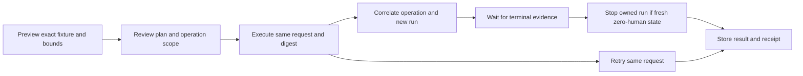

# Higher-level vehicle tools

Local implementation, 2026-10-15. The new adapter, worker commands and guarded
plugin are built/tested locally. Installed MCP configuration, worker files,
services and game worlds have not been changed by this work.

## A small vehicle profile

Set `VOIDWRIGHT_TOOL_PROFILE=vehicle` in the operator-owned adapter environment.
Keep `VOIDWRIGHT_READ_ONLY_ONLY=true` for human gameplay and observation. This
profile exposes four tools instead of the full low-level catalog:

| Tool | One useful operation |
| --- | --- |
| `voidwright_snapshot_status` | Discover bounded enrolled agent/grid IDs with freshness, run and tick from one snapshot |
| `observe_voidwright_vehicle` | Motion, gravity-relative tilt, equipment counts, current integrity and explicit unknowns |
| `view_voidwright_vehicle` | Reusable automatically framed chase/front/left/right/top view; optionally one HoloView image |
| `query_voidwright_body` | Bounded block page and optional damage wireframe |

An explicitly enabled lab profile adds only `voidwright_lab_trial`, for five
tools total. The ordinary profile remains `full` and retains the older tools
and compatibility goal entry point. An invalid profile refuses startup rather
than silently choosing a broader catalog. Profile selection is not an
authorization mechanism and creates no fixture or engine authority.

The compact profile serializes entity IDs as canonical strings, including
nested body and capture receipt IDs. Clock counters remain numeric. Use exact
identities from discovery rather than converting them through JavaScript
numbers. An Agent Core is needed for enrolled-body observation; the separate
fixed-controller lab binding still supports an ordinary vehicle without one.

### Observe

`observe_voidwright_vehicle(agentId, gridEntityId?, expectedRunId?,
expectedSimulationTick?, requireFresh=true)` reads one snapshot. The default
grid is that agent's root. It reports world velocity, speed, forward/right
components, gravity-relative vertical speed and up-axis tilt. Zero natural
gravity leaves attitude/vertical reference unknown. Invalid pose frames,
mixed agent/envelope ticks, stale/future-clock observations and wrong expected
run/tick are refused. An explicit forensic read can set `requireFresh=false`;
it remains labeled stale and never becomes a control authorization.

Equipment counts describe exported definitions, not guessed vehicle classes.
Only 32 equipment categories are returned, with omitted counts. Labels and
fingerprints are bounded; invalid/oversized definitions become unknown.
Integrity is current exported state, not evidence of historical destruction.
Incomplete bodies remain incomplete. This is privileged simulator telemetry,
separate from what the software camera perceived or any terrain clearance.

### View

`view_voidwright_vehicle(agentId, gridEntityId, preset="chase",
distanceMeters=0, capture=true)` frames the selected grid's observed block
envelopes at 55 degrees. Zero distance chooses a standoff from their bounding
radius; an explicit distance must be 4–150 m and outside that envelope. The
existing 250 m grid-relative position bound remains in force.

The five presets reuse one named rig per selected grid rather than consuming
another perspective slot on each call. They follow the refreshed grid frame,
including vehicle tilt. A new run or changed structure retires stale named
rigs and binds a new one; ordinary raw perspectives retain their existing
fail-closed binding. `capture=false` configures only. No physical game camera,
block, LCD or world entity is created.

Configuration and capture can use different structural snapshots; both carry
their provenance. A capture still returns one bounded 256×256 PNG through the
existing HoloView mailbox. Its renderer counter remains separate from the
simulation tick. Saved-grid pixels do not establish terrain, character or
general scene coverage, safe driving clearance or continuous video. The
configuration reports whether its observed body bounds are complete.

## Reviewable, journaled lab trials

`voidwright_lab_trial(gpsTarget, action="preview")` queues and starts nothing.
It returns a VRageCage plan, `plan_sha256` and `plan.request.request_id` for
one exact configured fixture/grid/controller/front camera and GPS label.

After the separately required operation approval, execute using the same
target, `action="execute"`, `requestId` and `expectedPlanSha256`. Use
`action="status"` and that request ID to inspect the durable journal. Status
does not need a plan hash and never replays a command. The plan digest binds
the reviewed inputs; it is not itself permission to drive or a new actor grant.



VRageCage owns the lifecycle. The adapter supplies no arbitrary actor, worker
host, socket, controller, URL or actuator command from model arguments. Its
configured limits are fixed: 0.5 m/s, 3.1 m arrival radius, 1,800 simulation
ticks and a 300-second observation wait. Only the existing seven drive GPS
labels are accepted. `Observation Towers` stays observation-only.

Preflight verifies the destructive-lab/import contracts, stopped service,
empty command queue, exact dynamic grid and same-grid controller/camera,
unique finite GPS target, guarded plugin contract, staged package tree hashes,
and relevant world/config/staging hashes. Optional binary sector cache and
Magnetar source/profile documents are bound when present. Shared staging and
trial locks protect cooperating operations; manual low-level commands must
not be run concurrently with the workflow.

Each request ID has a durable private journal under
`.vragecage-trials/<request-id>.json`. A completed retry returns the recorded
result without launching again. Reusing that identity for a different plan,
or against a reprepared fixture identity, is refused. An interrupted journal
without a final result requires review rather than automatic replay. Do not
replace the request ID merely because a tool reply timed out.

Arrival requires matching operation/run/contract/package evidence and a
successful terminal receipt. Clean shutdown is separate. Outcomes include
`arrival-verified`, `completed-with-issues`, `stopped-without-arrival` and
`review-required`; the last may leave a pending command or server requiring
operator attention. A stored result describes the original trial, not current
service or player state. Journal status explicitly says so.

### Human presence and cleanup

The bounded destructive-lab actuator does not require an empty session, so a
connected operator may observe an interactive test. Human presence does not
change the command bounds or authorize ordinary saves. Sensor-only capture
remains observation-only. Older `human-connected` terminal evidence is still
treated as a failure and prevents automatic shutdown.

Automatic server shutdown additionally needs a fresh zero-human snapshot from the exact
configured path inside this copied World's Storage. The snapshot must postdate
this activation, be no more than ten seconds old, and contain a same-tick
`no_connected_humans` observation. Missing/stale evidence or a connected human
causes review-required cleanup rather than stopping the occupied server. A
changed active run is never stopped by this workflow. Do not interpret this
as a multiplayer controller or a proof that join/check/stop is atomic.

Current correlated operation evidence overrides a lagging exporter sample:
`human-connected` or `players-api-unavailable` leaves shutdown to operator
review even if the last exported count still says zero. Start consumes the
expected operation and exact command bytes under the lab lock. Stop pins the
expected run; a lifecycle lock serializes cooperating CLI starts/stops, so a
replacement queue or newly started run is refused at the consuming operation.

All existing `VOIDWRIGHT_LAB_*` pins remain required. The new adapter also
requires `VOIDWRIGHT_LAB_SNAPSHOT_RELATIVE_PATH`, for example
`Storage/<exact-exporter-storage>/agent-core-snapshot-v1.json`, relative to
the fixture's `World`. Paths cannot escape Storage or traverse symlinks. The
MCP adapter and CLI must run on the worker host; no new remote listener exists.

The legacy `voidwright_drive_lab_target` name uses this same workflow without
another lifecycle implementation. Its result now uses
`vragecage.lab-trial-result.v1`; callers must read the new snake-case result
fields. The compact profile excludes that one-call compatibility tool.

## Build and verification

```bash
dotnet run --project tests/Voidwright.CoreTests/Voidwright.CoreTests.csproj -c Release
dotnet run --project tests/Voidwright.AgentMcpTests/Voidwright.AgentMcpTests.csproj -c Release
SPACE_ENGINEERS_BIN64=/absolute/game/Bin64 scripts/check-server-plugin.sh
```

The separate compile-check project validates every plugin source against the
existing SDK without starting a server or writing build outputs into the
staged plugin source directory. It does not establish engine runtime behavior.
Compilation passed against both the desktop SDK and read-only copies of the
dedicated server's exact eight referenced assemblies; their differing hashes
were preserved in private verification evidence.

The worker's `test-lab-trial.py` exercises real copied-world contracts,
activation/quarantine files and journals. Its full CLI test uses the real
dispatcher with fake service processes and synthetic receipts. MCP tests use
real stdio messages with synthetic snapshots/renderer/CLI responses. None is
a genuine driving trial. See the VRageCage CLI contract for command examples.

Deployment still needs an exact reviewed adapter/worker/plugin scope and an
explicitly authorized disposable-engine smoke. The operator may remain
connected to observe bounded movement; automatic shutdown still requires fresh
zero-human evidence. No live installation, MCP profile change, staging, server
restart, vehicle movement, paid inference, commit or push was performed in this
implementation phase.
